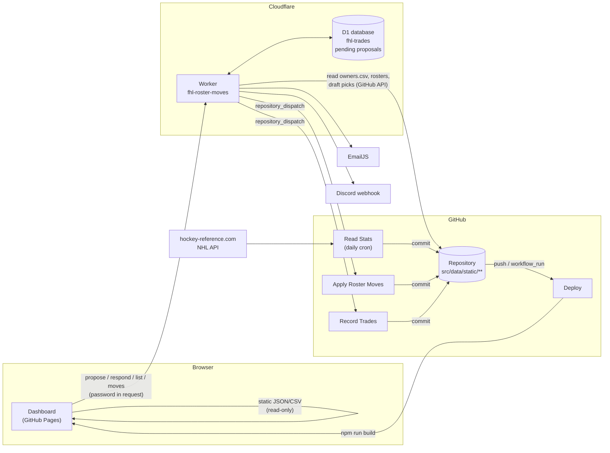

# FHL Dashboard: how the pieces fit together

The dashboard started as a static view of player stats. It is now a small system: a static site, a serverless API,
a database, an email service, scheduled and event-driven automation, and a Git repository that doubles as the
league's database. This document describes every moving part, how data flows between them, and where each secret and
credential lives. For day-to-day commands see the [README](../README.md); for Worker setup details see
[worker/README.md](../worker/README.md).

## The big idea

**The Git repository is the source of truth for everything the public can see.** Stats, rosters, draft picks, agreed
trades and roster moves are all files under `src/data/static/<season>/`. Nothing publishes to the website directly:
every change is a *commit*, and every commit triggers a rebuild and redeploy of the static site.

The only data that is **not** in the repo is private, in-flight state: pending trade proposals (in a D1 database) and
the passwords/secrets (in Cloudflare and GitHub settings).

## Components

### 1. The site: Observable Framework on GitHub Pages
- **What:** a static site built with [Observable Framework](https://observablehq.com/framework/). Pages are Markdown
  files in `src/*.md` (Standings, Teams, Draft Results, Roster, Compare Teams, Trades, Playoffs, ...). Navigation is
  configured in `observablehq.config.js`.
- **Data loaders** (`src/data/*.json.js`, `*.csv.js`) run at **build time**. They read the CSV/JSON files in
  `src/data/static/` and emit the JSON each page loads. Shared logic is in `src/components/`:
  `loadfiles.js` (reading seasons, stats and rosters; stat lines and ratings; contracts and cash),
  `playerRows.js` (the building blocks every loader composes its published player rows from),
  `leagueRules.js` (the league's rules in one place: 25 periods, minimum period cost, roster limits, positions, the
  stat weights and the record-by-rank table; also imported by the Worker and the GitHub scripts),
  `standingsHelpers.js` (period and season rankings) and `trades.js` (trade validation and "agreed trades" overlays).
- **Hosting:** GitHub Pages at `https://jduteau.github.io/fhl-dashboard-observable/`.
- **Important consequence:** the site has no server. Anything dynamic (submitting a lineup, proposing a trade) is the
  browser calling the Worker directly (below). Anything that must appear on the site is committed to the repo and
  only appears after the next deploy (typically a few minutes).
- **Multi-season:** `src/data/static/seasons.csv` lists seasons and which is `current`. Each season has its own folder.
  `autoCash` derives team cash from rosters and contracts; `stub` hides a season that has no data yet.

### 2. The Cloudflare Worker (`worker/`)
- **What:** the only server-side code. A Cloudflare Worker (`fhl-roster-moves`,
  `https://fhl-roster-moves.fhldashboard.workers.dev`) that the browser calls. It is deployed manually with
  `cd worker && npx wrangler deploy`; it is **not** deployed by GitHub Actions.
- **Why it exists:** the static site cannot hold secrets or verify a GM. The Worker checks the GM's password, enforces
  the trade rules, and is the only thing holding the GitHub token.
- **Files:** `index.js` (routing, CORS, roster moves), `trades.js` (trade endpoints), `email.js` (EmailJS and Discord),
  `accounts.js` (GM accounts, password hashing, lockout, `/account/*`), `lib.js` (GitHub access, CSV parsing), `schema.sql` (D1 tables), `wrangler.toml` (config), `test/`.
- **Endpoints** (all `POST`, JSON; requests from origins other than the allowed list are refused):

  | Endpoint | Who | What |
  | --- | --- | --- |
  | `/` | GM | Submit lineup moves for the next period -> `roster-moves` dispatch |
  | `/trades/propose` | GM | Create a proposal or counter-offer (stored in D1) |
  | `/trades/list` | GM | The GM's own proposals |
  | `/trades/respond` | GM | Accept / decline / withdraw; accept triggers the `trade-approved` dispatch |
  | `/trades/republish` | GM | Re-send accepted trades to GitHub if the trade log is missing one |
  | `/trades/admin-list` | Commissioner | Every proposal of the season, read-only |
  | `/account/get`, `/account/update` | GM | Read or change their own notification email and password |
  | `/account/admin-list`, `/account/admin-set` | Commissioner | List accounts; set any team's password or email (the only way to recover a forgotten password) |

- **Authentication:** every GM request carries the team abbreviation and password. The Worker checks it against a
  salted PBKDF2 hash in the D1 table `gm_accounts` (never sent to the browser). After 10 wrong passwords for a team in
  15 minutes that team is locked out for the rest of the window (`auth_failures` table). The commissioner endpoints use a
  separate `ADMIN_PASSWORD` secret, compared in constant time and throttled the same way. `owners.csv` only supplies
  public owner names and locations.
- **Trade rules enforced here:** each side must own what it gives (latest roster + draft picks, with already-agreed
  trades applied in order), both rosters must end with 20-36 players, and open proposals using an asset that has just
  been traded become `VOID`. A proposal expires when the next period's roster file appears.
- **Best-effort side effects:** emails and the Discord post run after the response is sent. If they fail, the failure
  is logged and the trade is unaffected.

### 3. The D1 database (`fhl-trades`)
- **What:** Cloudflare D1 (SQLite) bound to the Worker as `DB`. Two tables, defined in `worker/schema.sql`:
  `trades` (one row per proposal: teams, period, status, note, timestamps) and `trade_items` (the players/picks on each
  side).
- **Status lifecycle:** `PROPOSED` -> `ACCEPTED` | `DECLINED` | `WITHDRAWN` | `COUNTERED` | `VOID`. "Expired" and
  "Applied" are *derived* on read from whether the period's roster file exists; they are not stored.
- **Why a database and not the repo:** pending proposals are private (only the two GMs, and the commissioner, may see
  them) and change often. The repo is public-facing and every write is a commit that triggers a deploy.
- **Lifecycle of data:** once a trade is accepted it is *also* written to the repo (see Record Trades), so the public
  trade log never depends on D1. D1 is the working store for the negotiation.
- **Inspecting it:** `cd worker && npx wrangler d1 execute fhl-trades --remote --command "SELECT * FROM trades"`, or the
  Commissioner section of the Trades page.

### 4. GitHub Actions (`.github/workflows/`)
All workflows that change data commit to `master` as `github-actions[bot]`, and the Deploy workflow then rebuilds.

| Workflow | Trigger | What it does |
| --- | --- | --- |
| **Read Stats** (`read-stats.yml`) | Daily 13:00 UTC cron; manual (optional season/period) | Works out the current season and period (`.github/scripts/resolve-period.mjs`, from `seasons.csv` and `periods.csv`), builds `FHLScripts/`, scrapes hockey-reference.com into `stats_pNN.csv`, then adds any new players to `player_info.csv` (`update-player-info.mjs`, which prefers the NHL API and is rate-limited to be polite to scraped sites). |
| **Apply Roster Moves** (`apply-moves.yml`) | `roster-moves` dispatch from the Worker; manual "materialize" | On dispatch: validates and stores one team's moves in `moves/moves_pNN.json`. On manual run (the commissioner starting a new period): applies the agreed trades, then every team's stored moves, and writes `rosters_p(NN+1).csv`; traded picks are rewritten in `draft_picks.csv`. |
| **Record Trades** (`record-trades.yml`) | `trade-approved` dispatch from the Worker | Merges accepted trades into `trades/trades_pNN.json` (the public trade log). The Worker always sends *all* accepted trades for the period, so a dropped queued run cannot lose one. |
| **Deploy** (`deploy.yml`) | Push to `master`; after the three workflows above succeed; manual | `npm ci && npm run build`, publishes `dist/` to GitHub Pages. (Pushes made with the built-in token do not trigger the `push` trigger, which is why `workflow_run` is needed.) |

Workflows use only the built-in `GITHUB_TOKEN`; there are no custom Actions secrets. The two workflows that receive
Worker dispatches are serialized by separate concurrency groups so a trade can never displace a queued roster move.

### 5. EmailJS
- **What:** a hosted email-sending service. The Worker calls its REST API (`api.emailjs.com`) server-side, using a
  template (`EMAILJS_TEMPLATE_ID`) with the variables `to_email`, `to_name`, `subject`, `message`.
- **When:** every trade event (proposal, counter, accept, decline, withdraw) sends **one email addressed to both GMs**.
  Accepted trades also go to the league list (`LEAGUE_EMAIL`, a Google Group) with no lineup advice and no private note.
- **Addresses:** from the `email` column of the D1 `gm_accounts` table (set by the GM on My Account); it may hold several comma- or semicolon-separated
  addresses. Invalid addresses are dropped individually and logged by team, never by address.
- **Account setting required:** *Account > Security > allow API calls from non-browser applications*, because the
  Worker is not a browser.
- **Free-tier note:** EmailJS limits monthly sends. One email per event (not per GM) helps.

### 6. Discord (optional)
An accepted trade is also posted to a Discord channel through a webhook (`DISCORD_WEBHOOK_URL`), using the same text as
the league email, with mentions disabled. Unset means off.

### 7. External data sources
- **hockey-reference.com** (skater and goalie stats) via the scripts in `FHLScripts/`, a TypeScript project built with
  projen and pnpm inside the Read Stats workflow. Scraped sites block aggressive bots, so runs are polite and
  failures simply retry the next day.
- **NHL public API** for player name, birthdate and team when adding new players.

### 8. Local, manual tooling (not part of the automated flow)
- `fhlgetstats.sh`, `fhlgetplayerinfo.sh`, `fhlgetplayoffstats.sh`: older shell scripts to fetch data by hand
  (they are gitignored; Read Stats supersedes them for the regular season).
- `updateRoster.js`: builds the next roster from an *FHL Trader* transaction report (`fhl_trader.txt`), for
  transactions made outside the dashboard (waivers, free-agent signings). `countActiveRoster.js`: counts active players
  by position. The `current` symlink points at the current season folder for these scripts.
- Playoff data is maintained by hand: `playoff_bracket.csv`, `playoff_rounds.csv` and `stats_playoff_rNN.csv`.

## Walkthroughs

### A GM submits lineup moves
1. Roster page (Next Period tab) validates the lineup (20 active, 6-7 D, 2 G) against the roster *after* agreed trades.
2. Browser `POST`s `{season, period, team, password, promote, demote}` to the Worker.
3. Worker verifies the password against `owners.csv` (via the GitHub API) and sends a `roster-moves` dispatch.
4. **Apply Roster Moves** stores `moves/moves_pNN.json` and commits; **Deploy** rebuilds so the site reflects it.
5. Nothing changes in `rosters_pNN.csv` yet; that happens when the commissioner materializes the period.

### A trade, end to end
1. **Propose** (Compare Teams page): browser -> Worker `/trades/propose`. Worker validates ownership and roster sizes,
   writes to D1, emails both GMs (and nobody else).
2. **Respond** (Trades page): the other GM accepts, declines or counters (a counter marks the original `COUNTERED`).
3. **Accept**: Worker marks it `ACCEPTED` in D1, voids conflicting proposals, sends the `trade-approved` dispatch,
   emails both GMs and the league list, and posts to Discord.
4. **Record Trades** writes `trades/trades_pNN.json` and commits; **Deploy** publishes it to the public trade log.
5. From then on the Roster and Compare Teams pages show the post-trade state, so GMs set lineups for the roster they
   will actually have.
6. **New period** (commissioner runs *Apply Roster Moves* with "materialize"): trades are re-validated and applied
   to `rosters_pNN.csv` and `draft_picks.csv`; unapplicable ones are skipped with a warning in the run log; then the
   stored lineup moves are applied. Proposals still `PROPOSED` now read as `EXPIRED`.

### Stats arrive
Daily cron -> Read Stats scrapes the current period's stats, commits `stats_pNN.csv` (and any new `player_info.csv`
rows) -> Deploy rebuilds. No human involvement.

## Where each secret and setting lives

| Item | Where | Notes |
| --- | --- | --- |
| `GITHUB_TOKEN` (fine-grained PAT, Contents read/write on this repo) | Worker secret | Used to read rosters, `owners.csv` (public names) and send dispatches |
| `EMAILJS_PRIVATE_KEY` | Worker secret | Required for server-side sends |
| `ADMIN_PASSWORD` | Worker secret | Commissioner endpoints (trade view, account resets); unset = they refuse everyone |
| `DISCORD_WEBHOOK_URL` | Worker secret | Treat as a credential; unset = no Discord posts |
| `EMAILJS_SERVICE_ID`, `EMAILJS_PUBLIC_KEY`, `EMAILJS_TEMPLATE_ID`, `LEAGUE_EMAIL`, `SITE_URL`, `ALLOWED_ORIGIN`, `GITHUB_REPO` | `worker/wrangler.toml` | Non-secret config, committed |
| D1 binding `DB` (`database_id`) | `worker/wrangler.toml` | Created once with `wrangler d1 create` |
| GM password hashes and emails | D1 table `gm_accounts` | Not in the repo or on the site; seeded once by `worker/seed-accounts.mjs` |
| Worker URL (`WORKER_URL`) | `src/Roster.md`, `src/components/trades.js` | Hard-coded in the pages |

Set Worker secrets with `cd worker && npx wrangler secret put NAME`. List them with `npx wrangler secret list`.

## Security notes and known limitations

- GM passwords are stored only as salted PBKDF2 hashes in D1 and emails only in D1, so neither is in the public
  repository or the built site. Older commits of `owners.csv` still contain the original plain-text passwords and
  emails (history was not rewritten), so those passwords should be changed (My Account or the commissioner reset).
  Passwords are a light barrier, not strong security: they are sent with each request (no session), and the lockout is
  per team, so someone could deliberately lock a GM out for 15 minutes. Cloudflare rate-limiting rules can be added in
  front of the Worker if abuse becomes a concern.
- A forgotten password is reset by the commissioner only (there is no emailed reset link).
- The commissioner password is separate and stored only as a Worker secret.
- The Worker only accepts browser requests from the origins in `ALLOWED_ORIGIN`. This stops other websites from using a
  visitor's browser, but it is not authentication; the password is.
- Because everything public flows through Git, a bad data commit is visible and revertible, but also immediately
  deployed. The Deploy workflow is the only gate.
- The Worker is deployed by hand. After changing `worker/` code, someone must run `npx wrangler deploy`; merging to
  `master` does not do it.
- `package.json` still has an `observable deploy` script (Observable Cloud); production deploys go through GitHub Pages.

## Operational cheat sheet

| I want to... | Do this |
| --- | --- |
| Start a new period | Actions tab -> **Apply Roster Moves** -> Run workflow (materialize) |
| Re-run stats for a period | Actions tab -> **Read Stats** -> Run workflow, optionally enter season and period |
| Redeploy the site | Actions tab -> **Deploy** -> Run workflow |
| See every trade proposal | Trades page -> Commissioner section (needs `ADMIN_PASSWORD`) |
| Watch Worker logs | `cd worker && npx wrangler tail` |
| Deploy Worker changes | `cd worker && npx wrangler deploy` |
| Run the tests | `node --test worker/test/trades.test.mjs .github/scripts/test/trades-lib.test.mjs test/trades-component.test.mjs` |
| Change a GM's password or email | Edit `src/data/static/<season>/owners.csv`, commit, (the Worker reads it live) |
| A trade is accepted but missing from the log | Either GM presses **Re-send** on the Trades page |
| Start a new season | Add a row to `seasons.csv`, create the season folder (`team_info.csv`, `owners.csv`, `draft_picks.csv`, ...), set `current` |
