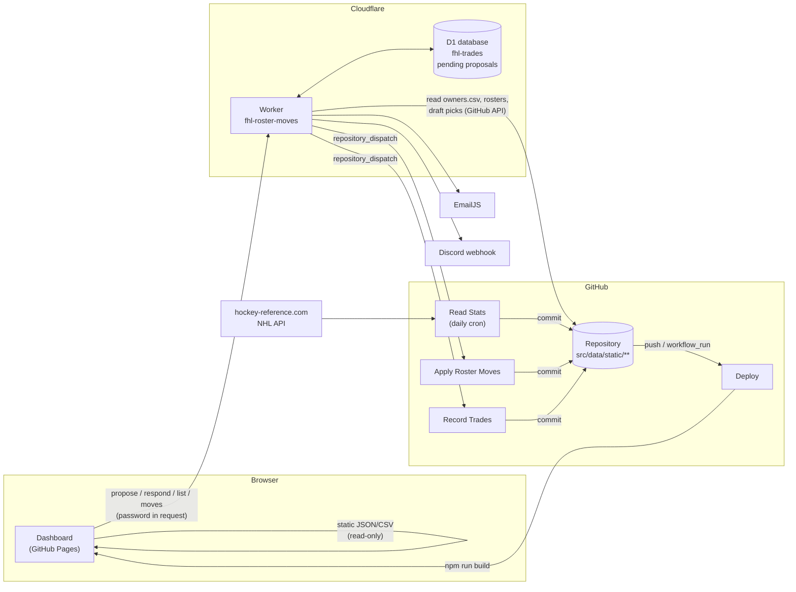

# FHL Dashboard: how the pieces fit together

The dashboard started as a static view of player stats. It is now a small system: a static site, a serverless API,
a database, an email service, scheduled and event-driven automation, and a Git repository that doubles as the
league's database. This document describes every moving part, how data flows between them, and where each secret and
credential lives. For day-to-day commands see the [README](../README.md); for Worker setup details see
[worker/README.md](../worker/README.md).

## The big idea

**The Git repository is the source of truth for everything the public can see.** Stats, rosters, draft picks, agreed
trades and roster moves are all files under `src/data/static/<season>/`. Nothing publishes to the website directly:
every change is a *commit*, and every commit triggers a rebuild and redeploy of the static site.

The only data that is **not** in the repo is private, in-flight state: pending trade proposals (in a D1 database) and
the passwords/secrets (in Cloudflare and GitHub settings).

## Components

### 1. The site: Observable Framework on GitHub Pages
- **What:** a static site built with [Observable Framework](https://observablehq.com/framework/). Pages are Markdown
  files in `src/*.md` (Standings, Teams, Draft Results, Roster, Compare Teams, Trades, Playoffs, ...). Navigation is
  configured in `observablehq.config.js`.
- **Data loaders** (`src/data/*.json.js`, `*.csv.js`) run at **build time**. They read the CSV/JSON files in
  `src/data/static/` and emit the JSON each page loads. Shared logic is in `src/components/`:
  `loadfiles.js` (reading seasons, stats and rosters; stat lines and ratings; contracts and cash),
  `playerRows.js` (the building blocks every loader composes its published player rows from),
  `leagueRules.js` (the league's rules in one place: 25 periods, minimum period cost, roster limits, positions, the
  stat weights and the record-by-rank table; also imported by the Worker and the GitHub scripts),
  `ranking.js` (how teams are ranked on the five stats and overall, shared by the standings and the playoffs),
  `standingsHelpers.js` (period and season rankings), `playoffHelpers.js` (playoff matchups),
  `tradeRules.js` (the identifier formats and "can this trade happen?" check shared by the Worker and the roster script)
  and `trades.js` (trade validation and "agreed trades" overlays).
  A season whose first roster exists before any stats counts as period 1 with nothing played yet, so a brand-new season
  builds; the loaders publish `latestPeriod` (the period in progress) and the pages use it. Static scripts and styles
  shared by pages are in `src/js/` (`season-selector.js`, `tabs.js`) and `src/styles/`.
- **Hosting:** GitHub Pages at `https://jduteau.github.io/fhl-dashboard-observable/`.
- **Important consequence:** the site has no server. Anything dynamic (submitting a lineup, proposing a trade) is the
  browser calling the Worker directly (below). Anything that must appear on the site is committed to the repo and
  only appears after the next deploy (typically a few minutes).
- **Multi-season:** `src/data/static/seasons.csv` lists seasons and which is `current`. Each season has its own folder.
  `autoCash` derives team cash from rosters and contracts; `stub` hides a season that has no data yet.

### 2. The Cloudflare Worker (`worker/`)
- **What:** the only server-side code. A Cloudflare Worker (`fhl-roster-moves`,
  `https://fhl-roster-moves.fhldashboard.workers.dev`) that the browser calls. It is deployed manually with
  `cd worker && npx wrangler deploy`; it is **not** deployed by GitHub Actions.
- **Why it exists:** the static site cannot hold secrets or verify a GM. The Worker checks the GM's password, enforces
  the trade rules, and is the only thing holding the GitHub token.
- **Files:** `index.js` (routing, CORS, roster moves), `trades.js` (trade endpoints), `email.js` (EmailJS and Discord),
  `accounts.js` (GM accounts, password hashing, per-caller lockout, `/account/*`), `lib.js` (GitHub access, CSV parsing), `schema.sql` (D1 tables), `wrangler.toml` (config), `test/`.
- **Endpoints** (all `POST`, JSON; requests from origins other than the allowed list are refused):

  | Endpoint | Who | What |
  | --- | --- | --- |
  | `/` | GM | Submit lineup moves for the next period -> `roster-moves` dispatch |
  | `/transactions/add`, `/transactions/remove` | Commissioner | Record (a batch of) or remove free-agent signings / waiver cuts / waiver claims for the next period -> one `transaction` dispatch |
| `/trades/propose` | GM | Create a proposal or counter-offer (stored in D1) |
  | `/trades/list` | GM | The GM's own proposals |
  | `/trades/respond` | GM | Accept / decline / withdraw; accept triggers the `trade-approved` dispatch |
  | `/trades/republish` | GM | Re-send accepted trades to GitHub if the trade log is missing one |
  | `/trades/admin-list` | Commissioner | Every proposal of the season, read-only |
  | `/account/get`, `/account/update` | GM | Read or change their own notification email and password |
  | `/account/admin-list`, `/account/admin-set` | Commissioner | List accounts; set any team's password or email (the only way to recover a forgotten password) |

- **Authentication:** every GM request carries the team abbreviation and password. The Worker checks it against a
  salted PBKDF2 hash in the D1 table `gm_accounts` (never sent to the browser). Wrong passwords are counted per caller (the
  IP address Cloudflare reports) in the D1 table `login_failures`: 10 wrong passwords for one account from one caller in
  15 minutes lock that caller out of that account, and 40 wrong passwords of any kind lock that caller out of everything
  (which stops one address working through all the teams). Because the count is per caller, a stranger guessing at a team
  only locks themselves out, never the GM. The commissioner endpoints use a separate `ADMIN_PASSWORD` secret, compared in
  constant time and throttled the same way. An unexpected failure returns a generic "Server error" to the browser; the
  detail is in the Worker log. `owners.csv` only supplies
  public owner names and locations.
- **Trade rules enforced here:** each side must own what it gives (latest roster + draft picks, with already-agreed
  trades applied in order), both rosters must end with 20-36 players, and open proposals using an asset that has just
  been traded become `VOID`. A proposal expires when the next period's roster file appears.
- **Best-effort side effects:** emails and the Discord post run after the response is sent. If they fail, the failure
  is logged and the trade is unaffected.

### 3. The D1 database (`fhl-trades`)
- **What:** Cloudflare D1 (SQLite) bound to the Worker as `DB`. Two tables, defined in `worker/schema.sql`:
  `trades` (one row per proposal: teams, period, status, note, timestamps) and `trade_items` (the players/picks on each
  side).
- **Status lifecycle:** `PROPOSED` -> `ACCEPTED` | `DECLINED` | `WITHDRAWN` | `COUNTERED` | `VOID`. "Expired" and
  "Applied" are *derived* on read from whether the period's roster file exists; they are not stored.
- **Why a database and not the repo:** pending proposals are private (only the two GMs, and the commissioner, may see
  them) and change often. The repo is public-facing and every write is a commit that triggers a deploy.
- **Lifecycle of data:** once a trade is accepted it is *also* written to the repo (see Record Trades), so the public
  trade log never depends on D1. D1 is the working store for the negotiation.
- **Inspecting it:** `cd worker && npx wrangler d1 execute fhl-trades --remote --command "SELECT * FROM trades"`, or the
  Commissioner section of the Trades page.

### 4. GitHub Actions (`.github/workflows/`)
All workflows that change data commit to `master` as `github-actions[bot]`, and the Deploy workflow then rebuilds.

| Workflow | Trigger | What it does |
| --- | --- | --- |
| **Read Stats** (`read-stats.yml`) | Daily 13:00 UTC cron; manual (optional season/period) | Works out the current season and period (`.github/scripts/resolve-period.mjs`, from `seasons.csv` and `periods.csv`), builds `FHLScripts/`, scrapes hockey-reference.com into `stats_pNN.csv`, then adds any new players to `player_info.csv` (`update-player-info.mjs`, which prefers the NHL API and is rate-limited to be polite to scraped sites). |
| **Apply Roster Moves** (`apply-moves.yml`) | `roster-moves` dispatch from the Worker; manual "materialize" | On dispatch: validates and stores one team's moves in `moves/moves_pNN.json` (runs in parallel; see *Concurrent dispatches* below). On manual run (the commissioner starting a new period): applies the agreed trades, then every team's stored moves, and writes `rosters_p(NN+1).csv`; traded picks are rewritten in `draft_picks.csv`. |
| **Record Trades** (`record-trades.yml`) | `trade-approved` dispatch from the Worker | Merges accepted trades into `trades/trades_pNN.json` (the public trade log). The Worker always sends *all* accepted trades for the period, so a dropped queued run cannot lose one. |
| **Record Transactions** (`record-transactions.yml`) | `transaction` dispatch from the Worker | Adds (or removes) a batch of commissioner-entered free-agent signings, waiver cuts and waiver claims in `transactions/transactions_pNN.json`. Checked against the latest roster plus the transactions already recorded. |
| **Deploy** (`deploy.yml`) | Push to `master`; after the three workflows above succeed; manual | `npm ci && npm test && npm run build`, publishes `dist/` to GitHub Pages. **Nothing is deployed unless the tests pass**, so a bad commit (code or data) leaves the live site as it was. (Pushes made with the built-in token do not trigger the `push` trigger, which is why `workflow_run` is needed.) |
| **Test** (`test.yml`) | Pull requests; manual | `npm ci && npm test && npm run build`: the same checks Deploy runs, for a change that has not been pushed to `master` yet. |

Workflows use only the built-in `GITHUB_TOKEN`; there are no custom Actions secrets.

**Concurrent dispatches.** GMs can submit at nearly the same time, and each submission is its own run that edits and
pushes the same data files. Three things make that safe:
- **Check out the branch tip, not the dispatch commit.** For `repository_dispatch`, `actions/checkout` defaults to the
  commit the branch pointed at when the event was *sent*. A run that waited in a queue would start from a stale tree,
  miss the previous run's commit and conflict when pushing, so the dispatch workflows check out
  `github.event.repository.default_branch` explicitly.
- **Roster moves are never queued.** GitHub keeps only *one pending* run per concurrency group, so a third submission
  arriving while one run executes and one waits would cancel the waiting run and silently lose that team's moves (each
  dispatch carries just one team's moves). Apply Roster Moves therefore gives each dispatch its own group
  (`apply-moves-<run_id>`) so none is cancelled; only the commissioner's materialize runs share a group. To keep
  parallel runs from conflicting, the commit step *redoes* the work instead of rebasing: each attempt fetches the branch
  tip, resets to it, re-runs the script, commits and pushes, and a rejected push (another run got there first) just
  starts over on top of the new tip (up to 8 attempts). A script failure, such as invalid moves, is a real error and
  fails the run without retrying.
- **Record Trades** keeps a serialized group (separate from the others, so a trade can't displace a queued roster
  move). That is safe because the payload is self-healing: the Worker re-sends every accepted trade for the period and
  they merge by id, so a dropped queued run is made up for by the next one. It keeps the `git pull --rebase` retry.
- **Record Transactions** also keeps a serialized group and the rebase retry, but its dispatches are *not*
  self-healing: each carries only its own batch. A third batch queued while one runs and one waits would cancel the
  waiting one. Only the commissioner submits these, one batch at a time, so this is unlikely in practice; if it ever
  matters, give it the same per-run group + redo-on-reject commit step as Apply Roster Moves.

### 5. EmailJS
- **What:** a hosted email-sending service. The Worker calls its REST API (`api.emailjs.com`) server-side, using a
  template (`EMAILJS_TEMPLATE_ID`) with the variables `to_email`, `to_name`, `subject`, `message`.
- **When:** every trade event (proposal, counter, accept, decline, withdraw) sends **one email addressed to both GMs**.
  Accepted trades also go to the league list (`LEAGUE_EMAIL`, a Google Group) with no lineup advice and no private note.
- **Addresses:** from the `email` column of the D1 `gm_accounts` table (set by the GM on My Account); it may hold several comma- or semicolon-separated
  addresses. Invalid addresses are dropped individually and logged by team, never by address.
- **Account setting required:** *Account > Security > allow API calls from non-browser applications*, because the
  Worker is not a browser.
- **Free-tier note:** EmailJS limits monthly sends. One email per event (not per GM) helps.

### 6. Discord (optional)
An accepted trade is also posted to a Discord channel through a webhook (`DISCORD_WEBHOOK_URL`), using the same text as
the league email, with mentions disabled. Unset means off.

### 7. External data sources
- **hockey-reference.com** (skater and goalie stats) via the scripts in `FHLScripts/`, a TypeScript project built with
  projen and pnpm inside the Read Stats workflow. Scraped sites block aggressive bots, so runs are polite and
  failures simply retry the next day.
- **NHL public API** for player name, birthdate and team when adding new players.

### 8. Local, manual tooling (not part of the automated flow)
- `fhlgetstats.sh`, `fhlgetplayerinfo.sh`, `fhlgetplayoffstats.sh`: older shell scripts to fetch data by hand
  (they are gitignored; Read Stats supersedes them for the regular season).
- `updateRoster.js`: builds the next roster from an *FHL Trader* transaction report (`fhl_trader.txt`), for
  transactions made outside the dashboard (waivers, free-agent signings). `countActiveRoster.js`: counts active players
  by position. Both work on the season marked `current` in `seasons.csv` (`updateRoster.js` also takes `--season`;
  `countActiveRoster.js` reads the season from the roster file's path).
- Playoff data is maintained by hand: `playoff_bracket.csv`, `playoff_rounds.csv` and `stats_playoff_rNN.csv`.

## Walkthroughs

### A GM submits lineup moves
1. Roster page (Next Period tab) validates the lineup (20 active, 6-7 D, 2 G) against the roster *after* agreed trades.
2. Browser `POST`s `{season, period, team, password, promote, demote}` to the Worker.
3. Worker verifies the password against `owners.csv` (via the GitHub API) and sends a `roster-moves` dispatch.
4. **Apply Roster Moves** stores `moves/moves_pNN.json` and commits; **Deploy** rebuilds so the site reflects it.
5. Nothing changes in `rosters_pNN.csv` yet; that happens when the commissioner materializes the period.

### A trade, end to end
1. **Propose** (Compare Teams page): browser -> Worker `/trades/propose`. Worker validates ownership and roster sizes,
   writes to D1, emails both GMs (and nobody else).
2. **Respond** (Trades page): the other GM accepts, declines or counters (a counter marks the original `COUNTERED`).
3. **Accept**: Worker marks it `ACCEPTED` in D1, voids conflicting proposals, sends the `trade-approved` dispatch,
   emails both GMs and the league list, and posts to Discord.
4. **Record Trades** writes `trades/trades_pNN.json` and commits; **Deploy** publishes it to the public trade log.
5. From then on the Roster and Compare Teams pages show the post-trade state, so GMs set lineups for the roster they
   will actually have.
6. **New period** (commissioner runs *Apply Roster Moves* with "materialize"): trades are re-validated and applied
   to `rosters_pNN.csv` and `draft_picks.csv`; unapplicable ones are skipped with a warning in the run log; then the
   stored lineup moves are applied. Proposals still `PROPOSED` now read as `EXPIRED`.
   Running it again is safe: while the new period has not started (no `stats_pNN.csv` for it yet) it rebuilds the same
   `rosters_pNN.csv` from the period before, picking up trades agreed and moves submitted since (picks it already moved
   are handed back first, so nothing is applied twice). Once the period has stats, the next run creates the following one.

### Free agents and waivers
1. The commissioner uses the **Free Agents & Waivers** page (commissioner password) as transactions show up in FHL Trader.
   Three kinds: *waive* (a team cuts a player), *claim* (a team claims a player off waivers: he moves straight from the
   other team, keeping his contract and active/reserve status, like a trade the commissioner makes), and *sign* (a team adds a
   free agent in reserve for a salary; the contract is always `C-YY`, e.g. `C-27` in 2026-27). A waiver run can be dozens,
   so the page builds a list (a form, or pasted lines such as `claim BOS from ANA Player Name`), shows it, and submits it
   all at once. A signed player must already be in `player_info.csv`.
2. Worker `/transactions/add` checks the commissioner password and plays the whole list forward in order on top of what is
   already recorded (the player is free / on that team at each step). One bad line rejects the batch, naming the line.
   Then it sends ONE `transaction` dispatch for the whole batch.
3. **Record Transactions** stores them in `transactions/transactions_pNN.json` (NN = next period); Deploy rebuilds.
4. A player signed this period cannot be traded until the next period (the Worker refuses it; Compare Teams does not offer
   them). The Roster (Next Period tab), Compare Teams and Trades pages, and the Worker's trade checks, all apply the recorded
   transactions first, then the agreed trades, so GMs set lineups and trade against the roster they will really have.
5. **New period** (materialize): the transactions are applied in the order entered (cuts drop players, claims move them,
   signings add them in reserve and get a `contracts.csv` row for the new period), then trades and GM lineup moves. Re-running
   is safe.
6. **Waiver cuts cost cash.** A cut costs half the player's salary for the part of his contract still to run, as a fraction of
   a season: `C-27 $6` cut for period 8 is 1/2 x 6 x (18/25) = $2.16, and `C-28` adds 25 periods (43/25) = $5.16. Draft (`D26`)
   and under-22 (`U22`) contracts cost nothing (`waiverCost` in `leagueRules.js`; it matches the FHL Trader report). The cost
   is not stored: for an `autoCash` season the loader recomputes it from the contract and the period, and takes it off the
   team's cash from the period the cut was applied (`computeTeamCash`), so cash going into the new period already reflects
   it. Until then, Compare Teams and Trades budget maths already subtract the pending cuts. Claims and signings cost
   nothing extra (a signing's salary is charged through the normal period cost).

**League report email.** When the materialize run pushes the new roster, it emails the league list (`fhltalk@googlegroups.com`)
an "FHL Trader Volume NNN (Week ending ...)" report: the applied trades, each team's roster moves, free-agent signings, waiver
claims and cuts (sections with nothing in them are left out). `apply-moves.mjs` builds it (`league-report-lib.mjs`) and the
workflow's last step sends it (`send-league-report.mjs`) through the same EmailJS template the Worker uses. It needs the
**`EMAILJS_PRIVATE_KEY` repository secret** (Settings > Secrets and variables > Actions; same value as the Worker secret); without it the
step only warns. Re-running materialize emails again, so untick the workflow's **email** box when re-running. The volume number
counts one per period from an anchor in `league-report-lib.mjs` (period 4 of 2026-27 = 577) and must be re-anchored for a new season.

### Stats arrive
Daily cron -> Read Stats scrapes the current period's stats, commits `stats_pNN.csv` (and any new `player_info.csv`
rows) -> Deploy rebuilds. No human involvement.

## Where each secret and setting lives

| Item | Where | Notes |
| --- | --- | --- |
| `GITHUB_TOKEN` (fine-grained PAT, Contents read/write on this repo) | Worker secret | Used to read rosters, `owners.csv` (public names) and send dispatches |
| `EMAILJS_PRIVATE_KEY` | Worker secret | Required for server-side sends |
| `ADMIN_PASSWORD` | Worker secret | Commissioner endpoints (trade view, account resets); unset = they refuse everyone |
| `DISCORD_WEBHOOK_URL` | Worker secret | Treat as a credential; unset = no Discord posts |
| `EMAILJS_SERVICE_ID`, `EMAILJS_PUBLIC_KEY`, `EMAILJS_TEMPLATE_ID`, `LEAGUE_EMAIL`, `SITE_URL`, `ALLOWED_ORIGIN`, `GITHUB_REPO` | `worker/wrangler.toml` | Non-secret config, committed |
| D1 binding `DB` (`database_id`) | `worker/wrangler.toml` | Created once with `wrangler d1 create` |
| GM password hashes and emails | D1 table `gm_accounts` | Not in the repo or on the site; seeded once by `worker/seed-accounts.mjs` |
| Worker URL (`WORKER_URL`) | `src/components/trades.js` | Defined once; the pages import it |

Set Worker secrets with `cd worker && npx wrangler secret put NAME`. List them with `npx wrangler secret list`.

## Security notes and known limitations

- GM passwords are stored only as salted PBKDF2 hashes in D1 and emails only in D1, so neither is in the public
  repository or the built site. Older commits of `owners.csv` still contain the original plain-text passwords and
  emails (history was not rewritten), so those passwords should be changed (My Account or the commissioner reset).
  Passwords are a light barrier, not strong security: they are sent with each request (no session). The lockout
  is per caller, so a stranger cannot lock a GM out, but someone using many addresses could still guess slowly; Cloudflare
  rate-limiting rules can be added in front of the Worker if abuse becomes a concern.
- A forgotten password is reset by the commissioner only (there is no emailed reset link).
- The commissioner password is separate and stored only as a Worker secret.
- The Worker only accepts browser requests from the origins in `ALLOWED_ORIGIN`. This stops other websites from using a
  visitor's browser, but it is not authentication; the password is.
- Because everything public flows through Git, a bad data commit is visible and revertible, but also immediately
  deployed. The Deploy workflow is the only gate.
- The Worker is deployed by hand. After changing `worker/` code, someone must run `npx wrangler deploy`; merging to
  `master` does not do it.
- `package.json` still has an `observable deploy` script (Observable Cloud); production deploys go through GitHub Pages.

## Operational cheat sheet

| I want to... | Do this |
| --- | --- |
| Start a new period | Actions tab -> **Apply Roster Moves** -> Run workflow (materialize) |
| Re-run stats for a period | Actions tab -> **Read Stats** -> Run workflow, optionally enter season and period |
| Redeploy the site | Actions tab -> **Deploy** -> Run workflow |
| See every trade proposal | Trades page -> Commissioner section (needs `ADMIN_PASSWORD`) |
| Watch Worker logs | `cd worker && npx wrangler tail` |
| Deploy Worker changes | `cd worker && npx wrangler deploy` |
| Run the tests | `node --test worker/test/trades.test.mjs .github/scripts/test/trades-lib.test.mjs test/trades-component.test.mjs` |
| Change a GM's password or email | Edit `src/data/static/<season>/owners.csv`, commit, (the Worker reads it live) |
| A trade is accepted but missing from the log | Either GM presses **Re-send** on the Trades page |
| Start a new season | Add a row to `seasons.csv`, create the season folder (`team_info.csv`, `owners.csv`, `draft_picks.csv`, ...), set `current` |
